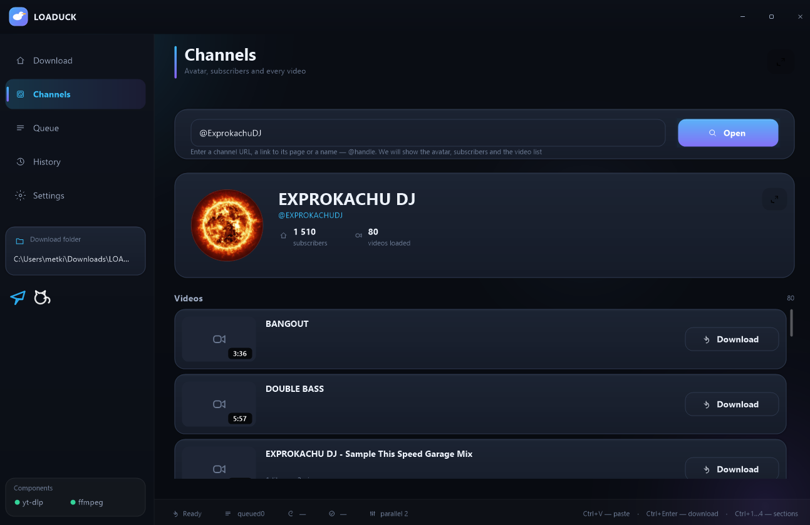
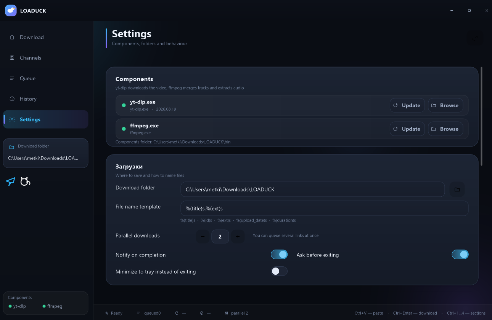

<h1 align="center">LOADUCK</h1>

<p align="center">
  
  
  
</p>

A native Windows application (C++ / Win32) for downloading videos from YouTube, TikTok, and 20+ other services.

Features a dark UI, video previews, quality selection, download queue, and history.

<p align="center">
  
</p>

<details>
<summary><strong>MORE PHOTOS</strong></summary>

<br>

<p align="center">
  
</p>

<p align="center">
  
</p>

</details>

## Features

- **Link Analysis** — thumbnail, title, creator, view count, duration, available quality options, and estimated file sizes.
- **Download Queue** — up to 8 concurrent downloads, pause/resume, cancel, retry, real-time progress, and download speed.
- **History** — downloaded files, timestamps, file sizes, and quick actions to reveal or delete files.
- **Settings** — download directory, filename template, maximum concurrent downloads, exit behavior, system tray toggle, and notifications.
- **Components** — built-in installation and updating of `yt-dlp` and `ffmpeg` directly from the application.
- **Convenience Features** — minimize to system tray, drag and drop links into the window, keyboard shortcuts, and clipboard integration.
- **Browser Extension** — send video links from supported websites directly to LO​​ADUCK using the browser extension.

**Supported services:** YouTube, TikTok, Instagram, X (Twitter), Facebook, Twitch, SoundCloud, Vimeo, Bilibili, and many others supported by `yt-dlp`.

## Requirements

| | |
|---|---|
| OS | Windows 10/11 version 1809 or later (x64) |
| Build | Visual Studio 2026 (MSVC 14.5x), C++20, Windows SDK 10.0.28000.0 |
| Components | `bin\yt-dlp.exe` (required), `bin\ffmpeg.exe` (for merging media streams and embedding metadata) |
| Browser extension | Google Chrome or Microsoft Edge with extension support |

Both `yt-dlp.exe` and `ffmpeg.exe` are included in the `bin` directory. If either is missing, open **Settings → Components** and click **Update**.

## Building

```bat
:: x64 / Release
msbuild LOADUCK.vcxproj -p:Configuration=Release -p:Platform=x64

:: Or use Visual Studio: open LOADUCK.sln
:: Select Release|x64 and build the project
```

The compiled executable will be located at:

`build\x64\Release\LOADUCK.exe`

> Close any running instance of `LOADUCK.exe` before rebuilding; otherwise, the linker may be unable to overwrite the executable.

## Running

Run the application:

```bat
build\x64\Release\LOADUCK.exe
```

You can also open a link directly from the command line:

```bat
build\x64\Release\LOADUCK.exe -Url "https://www.youtube.com/watch?v=dQw4w9WgXcQ"
```

## Browser Extension (Chrome / Edge)

The LO​​ADUCK browser extension allows you to send video links from your browser to the desktop application without manually copying and pasting URLs.

### Installation

1. Build or download LO​​ADUCK and locate the project folder.
2. Open Google Chrome and navigate to:

   `chrome://extensions/`

   For Microsoft Edge, navigate to:

   `edge://extensions/`

3. Enable **Developer mode** using the toggle in the top-right corner.
4. Click **Load unpacked**.
5. Open the LO​​ADUCK project directory and select the `extension` folder.

   Example project structure:

   ```text
   LOADUCK/
   ├── LOADUCK.exe
   ├── bin/
   │   ├── yt-dlp.exe
   │   └── ffmpeg.exe
   ├── extension/
   │   ├── manifest.json
   │   ├── popup.html
   │   ├── popup.js
   │   └── icons/
   └── src/
   ```

   The filenames shown above are illustrative; the actual extension files may differ.

6. Once installed, pin the LO​​ADUCK extension to the browser toolbar for convenient access.
7. Launch `LOADUCK.exe` before using the extension.

### How to Use

1. Open a video on a supported website, such as YouTube.
2. Click the LO​​ADUCK extension icon in your browser toolbar.
3. Use the extension's action to send the current video URL to LO​​ADUCK.
4. The desktop application can then analyze the link and let you select the available download quality.

### Updating the Extension

If the extension files change:

1. Open `chrome://extensions/` or `edge://extensions/`.
2. Find LO​​ADUCK in the list of installed extensions.
3. Click the reload icon on its extension card.

If you move the project to another directory, you may need to remove the extension and load the `extension` folder again.

### Troubleshooting

- **The extension does not appear:** Check that Developer mode is enabled and that you selected the correct `extension` folder.
- **The extension does not respond:** Check that the extension is enabled and reload it from the extensions page.
- **The desktop application does not receive the link:** Make sure LO​​ADUCK is running and that the extension-to-application integration has been configured correctly.
- **The extension cannot be loaded:** Verify that the selected folder contains a valid `manifest.json` file.

> **Important:** Loading an unpacked extension only installs it in the browser. Communication with `LOADUCK.exe` must also be implemented in the project, for example through Native Messaging or another supported local integration. The extension's actual functionality depends on that implementation.

## Keyboard Shortcuts

| Shortcut | Action |
|---|---|
| `Ctrl+V` | Paste a link from the clipboard |
| `Ctrl+Enter` | Download or start analyzing the link if it hasn't been analyzed yet |
| `Ctrl+1…4` | Switch between Download, Queue, History, and Settings |
| `Esc` | Close the current panel or remove focus from the input field |

## Architecture

The project uses no third-party UI frameworks — only native Win32 APIs and GDI+.

| File | Description |
|---|---|
| `src/main.cpp` | Window, message loop, input handling, and application state |
| `src/render.h/.cpp` | GDI+ rendering abstraction: primitives, fonts, text, clipping, and image caching |
| `src/ui.h/.cpp` | UI widgets: buttons, chips, toggles, input fields, progress indicators, and tooltips |
| `src/pages.h/.cpp` | Four interface pages, header, sidebar, and status bar |
| `src/icons.h/.cpp` | Vector icons and application logo |
| `src/theme.h/.cpp` | Color palette, accent themes, and DPI scaling |
| `src/dlp.h/.cpp` | yt-dlp process management: analysis, download queue, progress tracking, HTTP downloads of thumbnails and components |
| `src/store.h/.cpp` | Settings and download history stored in `%LOCALAPPDATA%\LOADUCK` |
| `src/util.h/.cpp` | URL handling, formatting, dialogs, and clipboard integration |
| `src/json.h` | Lightweight JSON parser with no external dependencies |
| `src/toast.h/.cpp` | Toast notifications |

Rendering takes place in a 32-bit ARGB offscreen buffer, which is then displayed in a single `DrawImage` call. This enables smooth rendering at up to 60 FPS and supports translucent shadows and gradients without visible aliasing.

## Data Storage

Settings, download history, and logs are stored in:

`%LOCALAPPDATA%\LOADUCK`

You can access this directory using the **Open Folder** button in Settings.

## Disclaimer

LOADUCK acts as a frontend for `yt-dlp`. Downloading copyrighted material may violate applicable laws. Only download content you have the right to access and save.

---

<p align="center">
  <a href="https://ko-fi.com/SlippTech">
    
  </a>
  &nbsp;&nbsp;
  <a href="https://www.buymeacoffee.com/SLIPPTECH">
    
  </a>
</p>
